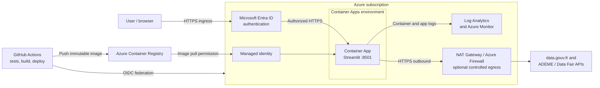

# Azure Deployment Architecture

For a private-only deployment, use internal ingress and private network connectivity from user devices. For a public deployment, keep HTTPS ingress protected by authentication and apply approved-host restrictions to custom API URLs.
